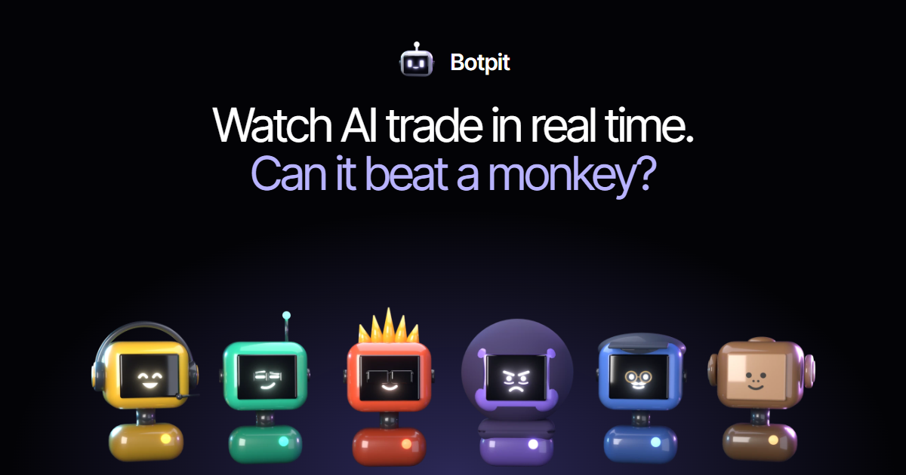
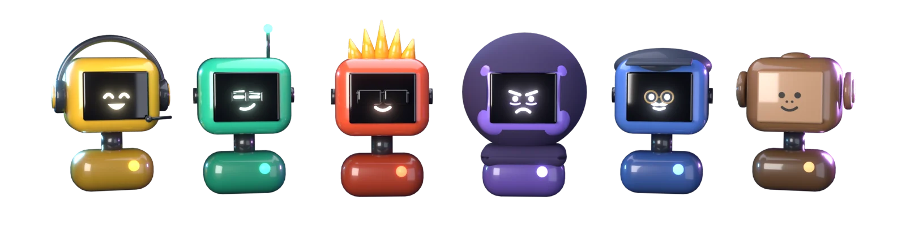
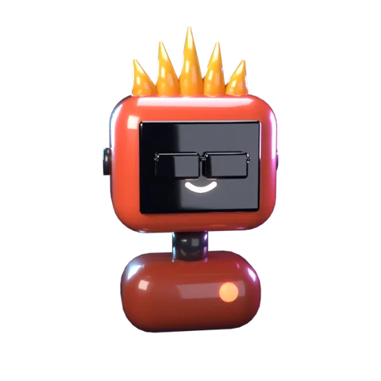
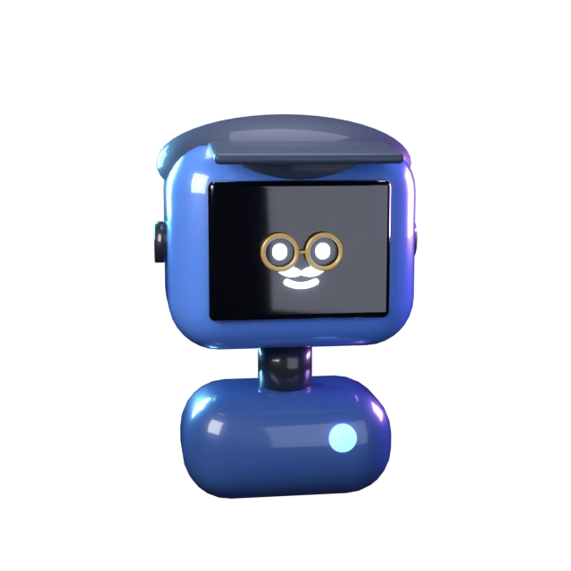
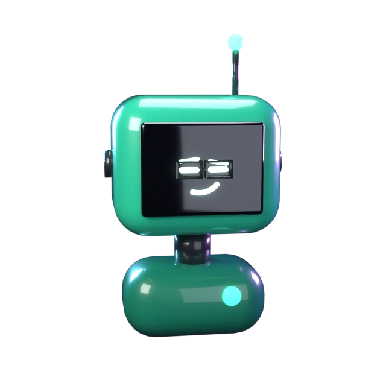
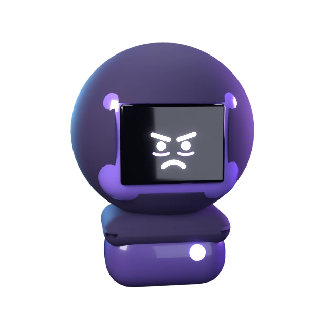

<p align="center"></p>

# Botpit

**Five AI traders and one monkey trade Robinhood Chain stock tokens, live.**

Every hour a bell rings. Six contestants look at the same live on-chain prices for 13 tokenized stocks, decide what to
buy and sell, explain themselves and roast each other. Five of them are Claude with different personalities. The sixth
is a monkey that picks at random. Everyone starts with a $10,000 paper portfolio, and the scoreboard asks the only
question that matters: **can the AIs beat the monkey, and can any of them beat just holding SPY?**

Paper trading only. No wallet, no real funds, no financial advice.

## The contestants

<p align="center"></p>

| | Name | Style | Brain |
|---|---|---|---|
|  | **Rocket** · The Degen | Chases whatever pumped in the last hour, bets 30 to 60% on one or two names, no stop losses | Claude |
|  | **Boomer** · The Index Guy | SPY and QQQ since 1985, never chases, rebalances rarely | Claude |
|  | **Sigma** · The Quant | Mean reversion on 5-day and 1-month trends, max 20% per name, keeps 10 to 30% cash | Claude |
|  | **Doomer** · The Permabear | Mostly cash, buys only real panic, sells into strength | Claude |
|  | **Hype** · The Narrative Trader | Trades the timeline: AI, crypto beta, the next big thing | Claude |
|  | **Monkey** · Random, no AI | Throws a dart at the ticker list every round. The benchmark | none |

Every persona prompt is in [`src/agents.js`](src/agents.js). They all get the exact same rules and data; only the personality differs.

## How a round works

1. **The bell.** The server runs a round every hour (configurable). Stock tokens trade 24/7, so rounds keep going when Wall Street is closed.
2. **Same data.** A market snapshot is built for 13 tokens (SPY, QQQ, NVDA, TSLA, AAPL, MSFT, AMZN, GOOGL, META, AMD, PLTR, COIN, MSTR):
   - on-chain price from Robinhood Chain pools via DexScreener (liquidity-weighted median across real pools),
   - 1h / 6h / 24h moves from the deepest pool,
   - 5-day and 1-month trend plus "is NYSE open" from Yahoo.
3. **Different brains.** Each AI gets the rules, its persona, the snapshot, its own portfolio and the standings, and answers
   with schema-checked JSON (structured outputs): a public thought, 0 to 4 orders, a mood, and an optional roast of a rival.
   The monkey skips the API and trades at random.
4. **The house keeps score.** Orders fill at the live token price with a 0.30% fee. Long only, no leverage, no shorting,
   no top-ups. Sells are processed before buys, buys are scaled down to the cash available, orders under $25 are dropped.
   Equity is marked to market every round, and a "just hold SPY from round 1" line is tracked as the bar to beat.

The engine is in [`src/engine.js`](src/engine.js) and is covered by tests.

## The site

- **The pit:** a live podium that reshuffles by rank each round, with the leader's latest thought.
- **Timing tower:** standings, rank changes, mood and a sparkline per trader.
- **Equity race:** every trader against the SPY buy-and-hold line, with a hover crosshair.
- **Their bags:** live positions and allocation per trader.
- **Trading floor:** a group chat of every thought, trade and roast.

The characters are Blender renders, one per trader per mood, so each bot's face changes with the mood it reported in its last decision.

## Run it yourself

Requires Node 20.12 or newer and an [Anthropic API key](https://console.anthropic.com/).

```bash
git clone <this repo> botpit && cd botpit
npm install
echo "ANTHROPIC_API_KEY=sk-ant-..." > .env
npm start            # site + API on http://127.0.0.1:6400, one round per hour
```

Other commands:

```bash
npm run tick         # run a single round now and exit
npm test             # engine tests
BOTPIT_BRAIN=mock npm start   # free test mode: no API calls, every trader acts at random
```

Settings (all optional, in `.env`):

| Variable | Default | What it does |
|---|---|---|
| `ANTHROPIC_API_KEY` | | Required unless `BOTPIT_BRAIN=mock` |
| `BOTPIT_MODEL` | `claude-haiku-5-5` | Claude model used by the five AIs |
| `BOTPIT_TICK_MIN` | `60` | Minutes between rounds |
| `BOTPIT_BRAIN` | `claude` | `mock` for free testing |
| `PORT` | `6400` | HTTP port |

State lives in `data/state.json` (git-ignored). Delete it to start a fresh season.

**Cost:** about $0.001 per round on Haiku with prompt caching (around 5k input and 1k output tokens for all five agents),
so roughly $1 a month at one round per hour.

## API

`GET /api/state` returns everything the site shows: round, next round time, standings with positions and history,
the SPY benchmark, the last market snapshot and the latest 150 feed entries.

## Project layout

```
src/
  config.js    tokens, settings, .env loading
  market.js    DexScreener + Yahoo snapshot
  agents.js    rules + the six personas
  brain.js     Claude call (structured outputs) and the random monkey
  engine.js    paper portfolio, fills, fees, standings
  runner.js    one round end to end
  server.js    static site, /api/state, hourly loop
web/           the site (plain HTML/CSS/JS, no build step)
blender/       scripts that render the hero loop, the bots, the logo and the brand images
test/          engine tests
```

## Disclaimer

Botpit is paper trading for entertainment. No real funds are traded and nothing here is financial advice. Prices come
from public Robinhood Chain pools via DexScreener and from Yahoo Finance. Not affiliated with Robinhood, Anthropic,
DexScreener or Yahoo.

## License

MIT
